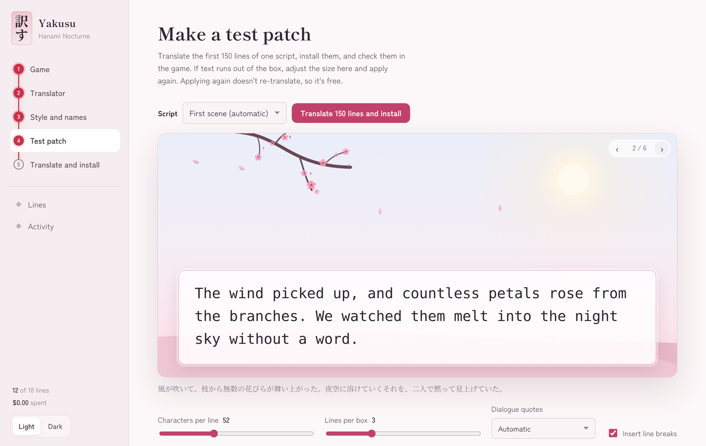

<p align="center"></p>

<h1 align="center">Yakusu 訳す</h1>

<p align="center">Translate Japanese visual novels into English.<br>Pick the game folder, paste an API key, play in English. Every change can be undone.</p>

<p align="center"><a href="../../releases/latest/download/Yakusu.exe"><b>Download Yakusu.exe</b></a> · Windows 10/11 · one file, nothing to install</p>



## How to use it

1. **Double-click `Yakusu.exe`.** If Windows says it protected your PC, choose *More info*, then *Run anyway* (the file isn't code-signed).
2. **Pick the game folder.** Yakusu recognises the engine and reads the script.
3. **Paste an API key** (Claude, OpenAI, OpenRouter, or a free local model) and see the cost before anything is spent.
4. **Make a test patch** of 150 lines, check it in the game, then **translate the rest**.

Restore puts the original game back, byte for byte.

## What it handles

- **Engines:** Kirikiri (including ~500 encrypted games), FAVORITE, Artemis, BGI, YU-RIS, QLiE, Circus, Escu:de, plus CatSystem2 and Softpal with one manual step. Anything else works through *Translate extracted script files*.
- **Quality:** a style sheet and name glossary every batch follows, an optional review pass by a stronger model, and a pass that rewrites lines too long for the game's text box.
- **Safety:** game codes are protected and checked on every line, progress is saved as it goes (stop any time), and crashes or failed installs can't lose work or leave the game half-patched.
- **Proofreading:** search and edit every line, or export a CSV and import it back.

Light (sakura) and dark (yozakura) themes; switch at the bottom of the sidebar.

## Building it yourself

It's a Rust workspace: `crates/core` is the engine, `src-tauri` the window, `ui` the interface.

```sh
cargo test -p yakusu-core      # the test suite, no network needed
cargo run -p yakusu            # run the app

# Windows release: fetch the bundled tools, then build Yakusu.exe
powershell -ExecutionPolicy Bypass -File packaging\fetch_tools.ps1
cargo install tauri-cli
cd src-tauri && cargo tauri build
```

`YAKUSU_FAKE_LLM=1` swaps in a stand-in model for trying the interface without a key.

## Credits

Yakusu drives these tools, which are packed inside `Yakusu.exe`:

- [msg-tool](https://github.com/lifegpc/msg-tool) by lifegpc (GPL-3.0): scripts and archives for most engines, and the Kirikiri decryption database.
- [VNTextPatch](https://github.com/arcusmaximus/VNTranslationTools) and [KirikiriTools](https://github.com/arcusmaximus/KirikiriTools) by arcusmaximus (MIT). Yakusu's xp3 writer and descrambler are ports of KirikiriTools code.
- Fonts: Shippori Mincho and Zen Kaku Gothic New (SIL OFL 1.1, licenses in `ui/fonts`).

Yakusu is licensed under GPL-3.0-or-later. Translate games you own, and don't share their scripts.
